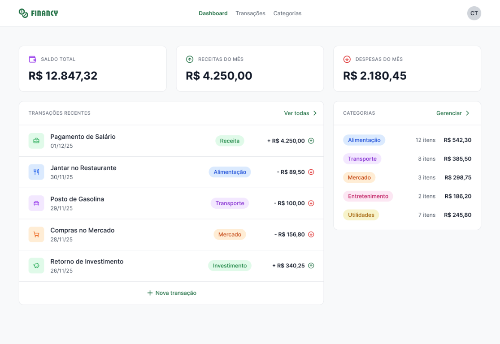

<p align="center">
  
</p>

# Financy

Aplicação fullstack de controle financeiro: dashboard com saldo, receitas e despesas, gerenciamento de transações e categorias.

## Tecnologias

### Backend (`/backend`)

| Tecnologia | Uso |
|---|---|
| Node.js + TypeScript | Runtime e linguagem |
| GraphQL | API |
| Apollo Server 5 | Servidor GraphQL |
| Prisma 7 | ORM e migrations |
| SQLite (`better-sqlite3` adapter) | Banco de dados |
| JSON Web Token (`jsonwebtoken`) | Autenticação |
| bcryptjs | Hash de senhas |
| dotenv | Variáveis de ambiente |
| tsx | Execução em desenvolvimento (watch) |

### Frontend (`/frontend`)

| Tecnologia | Uso |
|---|---|
| React 19 + TypeScript | Interface |
| Vite | Bundler e dev server |
| Tailwind CSS 4 | Estilização |
| React Router DOM 7 | Roteamento |
| TanStack React Query | Cache e requisições de dados |
| React Hook Form + Zod | Formulários e validação |
| Lucide React | Ícones |

## Como executar

### Backend

```bash
cd backend
cp .env.example .env   # defina JWT_SECRET
npm install
npm run dev            # http://localhost:4000
```

Variáveis: `JWT_SECRET`, `DATABASE_URL` (`file:./dev.db`), `PORT` (`4000`).

### Frontend

```bash
cd frontend
cp .env.example .env   # defina VITE_BACKEND_URL
npm install
npm run dev
```

## Scripts

- Backend: `dev`, `build`, `start`, `prisma:migrate`, `prisma:deploy`
- Frontend: `dev`, `build`, `preview`
